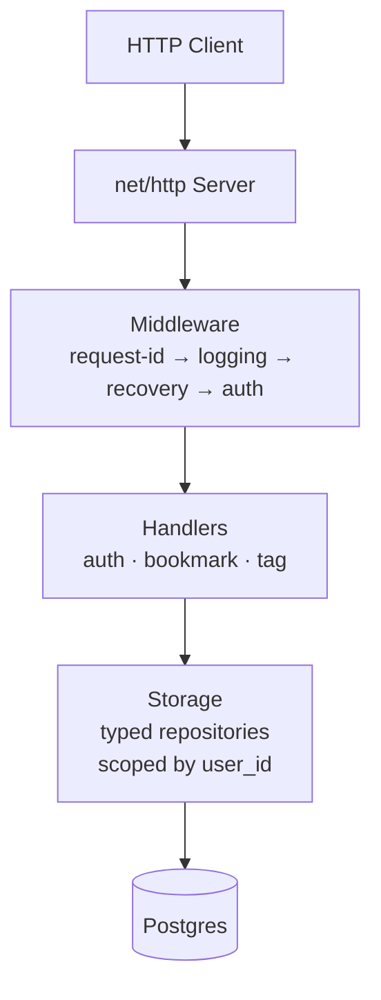

# Architecture — Bookmarks API V1

> Repository: https://github.com/Carlos20052030/bookmarks-api

How the service is put together, why each layer exists, and which decisions
were made along the way.

## 1. Overview

Bookmarks API is a single Go binary that speaks HTTP, talks to Postgres, and
does nothing else. It has no framework, no ORM, and no runtime dependency
beyond a Postgres connection and its own configuration.



## 2. Design Principles

1. **Single responsibility per package.** Every `internal/` package does one
   thing. `handler` never imports `storage`; it depends on an interface.

2. **Dependencies point inward.** `domain` depends on nothing. Everything
   else may depend on `domain`. Interfaces live where they are consumed,
   never where they are implemented.

3. **Standard library first.** `net/http`, `database/sql`, `log/slog`,
   `context`, `crypto/rand`. Third-party code only where the standard
   library cannot reasonably do the job.

4. **Fail loud, exit clean.** Startup errors exit non-zero with a structured
   log line. Runtime errors on a single request return a stable JSON body
   and never crash the process.

5. **No global state.** Every dependency is passed explicitly from
   `cmd/api/main.go`. Nothing is a package-level singleton.

6. **Ownership is enforced in SQL.** Not in middleware, not in handlers. The
   database query itself filters by `user_id`. If the filter is removed by
   accident, the IDOR tests break.

## 3. Component Responsibilities

| Package | Responsibility | Depends on |
|---|---|---|
| `cmd/api` | Read config, open DB, run migrations, wire handlers, start server | all internal packages |
| `internal/domain` | Shared types: `User`, `Bookmark`, `Tag`, `RefreshToken` | nothing |
| `internal/config` | Load and validate environment variables | `os` |
| `internal/auth` | Password hashing, JWT issue/parse, refresh token generation | `crypto/*`, `golang-jwt` |
| `internal/storage` | Postgres repositories, connection pool, migration runner | `database/sql`, `pgx`, `domain` |
| `internal/middleware` | Cross-cutting concerns: request ID, logging, panic recovery, auth | `net/http`, `auth` |
| `internal/handler` | HTTP handlers: parse request, call storage, write response | `storage` (via interfaces), `domain`, `auth` |
| `internal/server` | Compose the middleware chain and routes, own the `http.Server` | `net/http`, `handler`, `middleware` |

## 4. Domain Model

```go
type User struct {
    ID           uuid.UUID
    Email        string
    PasswordHash string
    CreatedAt    time.Time
    UpdatedAt    time.Time
}

type Bookmark struct {
    ID        uuid.UUID
    UserID    uuid.UUID
    URL       string
    Title     string
    Tags      []Tag
    CreatedAt time.Time
    UpdatedAt time.Time
}

type Tag struct {
    ID        uuid.UUID
    UserID    uuid.UUID
    Name      string
    CreatedAt time.Time
}

type RefreshToken struct {
    ID        uuid.UUID
    UserID    uuid.UUID
    TokenHash string
    ExpiresAt time.Time
    RevokedAt *time.Time
    CreatedAt time.Time
}
```

Two invariants hold across all packages:

- **IDs are UUIDv4.** Sequential integers would leak information (how many
  records exist, which IDs are valid). UUIDs make enumeration impractical.
- **`RefreshToken` stores the hash, never the plaintext.** A leaked database
  does not leak usable tokens.

## 5. Request Lifecycle

Every HTTP request goes through the same chain:

1. **`middleware.RequestID`** — generates a UUIDv4, stores it in the request
   context, echoes it in the `X-Request-Id` response header. A client-supplied
   header is ignored (spoof prevention).
2. **`middleware.Logging`** — records method, path, status, bytes, duration
   and the request ID on a single line, after the response is written.
3. **`middleware.Recovery`** — catches panics, logs the stack, replies
   `500 internal_server_error`, keeps the process alive.
4. **Route match** — `net/http` `ServeMux` with Go 1.22+ patterns
   (`GET /bookmarks/{id}`).
5. **`middleware.Auth`** (protected routes only) — validates the Bearer token,
   injects the user ID into the context. On any failure returns `401`.
6. **Handler** — parses JSON, validates input, calls a `storage` method,
   writes a JSON response.

The order matters. Request ID first so every log line has it. Logging
outside Recovery so a panic still produces a log line with `status=500`.

## 6. Authentication Flow

### Registration

```text
POST /auth/register {email, password}
    |
    +-- normalize email (lowercase + trim)
    +-- validate email shape and password length
    +-- bcrypt(password, cost 12)
    +-- INSERT INTO users ...
    +-- issue JWT access token (HS256, 15 min)
    +-- generate refresh token (32 random bytes -> base64url)
    +-- INSERT INTO refresh_tokens (hash only)
    +-- 201 {user, access_token, refresh_token}
```

### Login

```text
POST /auth/login {email, password}
    |
    +-- normalize email
    +-- SELECT user by email
    |       +-- if not found: run bcrypt against a dummy hash,
    |           return the same 401 as a wrong password
    +-- bcrypt.CompareHashAndPassword
    |       +-- if mismatch: 401
    +-- issue new JWT + new refresh token
    +-- 200 {user, access_token, refresh_token}
```

The dummy bcrypt call is deliberate: without it, a login for an unknown
email would return in milliseconds and a login for a known email would
return in ~200 ms. That timing difference lets an attacker enumerate
registered accounts. Running bcrypt on a hard-coded hash makes both
paths take approximately the same time.

### Refresh

```text
POST /auth/refresh {refresh_token}
    |
    +-- hash the incoming token (SHA-256)
    +-- SELECT refresh_token by hash
    |       +-- if not found: 401
    |       +-- if revoked:  REUSE DETECTED
    |       |                revoke every active refresh token
    |       |                for that user, return 401
    |       +-- if expired: 401
    +-- revoke the presented token
    +-- issue new access + refresh pair
    +-- 200 {access_token, refresh_token}
```

Reuse detection is the most important part. If the same refresh token
appears twice, one of two things happened: the client raced itself, or
the token was stolen. Neither is safe, so every session for that user
is revoked. The attacker gains nothing, and the legitimate user sees
their other sessions close — a visible signal that something is wrong.

## 7. Ownership Model

Every bookmark and every tag belongs to exactly one user. Every read,
write, and delete is scoped by `user_id` at the SQL level:

```sql
SELECT ... FROM bookmarks WHERE id = $1 AND user_id = $2
DELETE   FROM bookmarks WHERE id = $1 AND user_id = $2
UPDATE   bookmarks SET ... WHERE id = $1 AND user_id = $2
```

When the filter does not match, the query returns zero rows. The storage
layer translates that into `ErrNotFound`, and the handler returns `404`.

**Why `404`, not `403`.** A `403` would confirm the resource exists. A `404`
is indistinguishable from "no such resource", which leaks nothing about
other users' data.

Attach/detach validates **both** sides:

```sql
SELECT
    EXISTS (SELECT 1 FROM bookmarks WHERE id = $1 AND user_id = $3)
    AND
    EXISTS (SELECT 1 FROM tags      WHERE id = $2 AND user_id = $3)
```

Only if both are owned by the same user is the link written. This blocks
the subtle attack where a user tries to attach someone else's tag to
their own bookmark.

## 8. Storage Layer

`storage.Store` wraps a `*sql.DB` and exposes typed methods. Every method
takes a `context.Context` for cancellation.

The migration runner reads `.sql` files embedded in the binary via
`//go:embed`, applies any not yet recorded in `schema_migrations`, and
runs each one inside its own transaction. Re-running the service is a
no-op.

Connection pool limits:

| Setting | Value | Reason |
|---|---|---|
| `MaxOpenConns` | 10 | Postgres default is 100; 10 is plenty for a single instance |
| `MaxIdleConns` | 5 | Keeps a warm pool without holding too many idle sockets |
| `ConnMaxLifetime` | 30 min | Avoids stale connections behind NAT or firewalls |

## 9. Error Handling

- **Startup errors** (config, DB, migrations) -> `slog.Error` and `os.Exit(1)`.
- **Handler errors** -> stable JSON body: `{"error":"code","message":"..."}`.
- **Panics** -> caught by middleware, logged with a full stack trace, `500` returned.
- **Context cancellation** -> propagates from the request context through
  `database/sql` and cancels the query.

No `panic` in production paths. Panics are reserved for programmer errors
(invariants that should never break).

## 10. Concurrency

The service is request-scoped. Each request runs in its own goroutine
(spawned by `net/http`). There is no shared mutable state between
requests — every dependency is either read-only or thread-safe
(`*sql.DB` is a pool, `*slog.Logger` is safe for concurrent use).

Graceful shutdown: on `SIGINT` or `SIGTERM`, `http.Server.Shutdown` stops
accepting new connections and waits up to 10 seconds for in-flight
requests to finish before returning.

## 11. Configuration

Configuration comes from environment variables, loaded once at startup
and validated. No hot reload — a change requires a restart.

Required variables:

```
POSTGRES_USER, POSTGRES_PASSWORD, POSTGRES_DB, POSTGRES_HOST, POSTGRES_PORT
JWT_SECRET (>= 32 bytes)
SERVER_PORT (default 8080)
LOG_LEVEL (default info)
```

If any required variable is missing or malformed, the process exits
before serving traffic.

## 12. Security Decisions

| Decision | Why |
|---|---|
| UUIDv4 IDs | Prevent enumeration; make guessing impractical |
| `404` instead of `403` for other users' resources | Avoid leaking resource existence |
| bcrypt cost 12 for passwords | Modern recommendation; ~200 ms per hash |
| SHA-256 for refresh tokens | Tokens have 256 bits of entropy; bcrypt only adds latency |
| HS256 JWT with `jwt.WithValidMethods(["HS256"])` | Blocks algorithm confusion attacks |
| Timing-safe login (dummy bcrypt) | Prevents user enumeration through response time |
| Refresh token rotation | Limits the window of a stolen token |
| Refresh reuse detection | Forces re-login on theft; revokes all sessions |
| `contextKey` as struct, not string | Prevents context key collisions |

## 13. Directory Layout

```text
bookmarks-api/
|-- cmd/api/                    main.go — process entry point
|-- internal/
|   |-- auth/                   bcrypt, JWT, refresh token helpers
|   |-- config/                 env loading and validation
|   |-- domain/                 shared types
|   |-- handler/                HTTP handlers and response helpers
|   |-- middleware/             request-id, logging, recovery, auth
|   |-- server/                 http.Server, routes, middleware chain
|   +-- storage/                Postgres repositories and migrations
|-- migrations/                 001_init.sql, 002_bookmarks.sql, embed.go
|-- scripts/                    backup.sh (pg_dump + rotation)
|-- docs/                       this file, deployment, postmortem
|-- Dockerfile                  multi-stage build
|-- docker-compose.yml          development
|-- docker-compose.prod.yml     production
+-- Makefile
```

## 14. Technical Decisions

| Decision | Choice | Reason | Trade-off |
|---|---|---|---|
| Language | Go 1.27 | Static binary, first-class HTTP, small containers | Smaller ecosystem than Node or Python |
| HTTP layer | `net/http` + `ServeMux` | No framework to learn; Go 1.22 patterns cover 95% of routing needs | Manual middleware chaining |
| Database | Postgres 17 | Mature, JSON support, `gen_random_uuid()` built in | Heavier than SQLite |
| DB driver | `pgx/v5/stdlib` | Actively maintained, best Postgres support in Go | Alternative `lib/pq` is frozen |
| Migrations | Versioned `.sql`, embedded | Zero runtime dependency, auditable in git | No down migrations |
| Config | Environment variables | Works with Docker Compose and any orchestrator | Requires restart to apply changes |
| Logging | `log/slog` | Structured, standard library | Fewer features than Zap or Zerolog |
| IDs | UUIDv4 | No enumeration | Larger indexes than `BIGSERIAL` |
| Auth | JWT + opaque refresh | Stateless access, revocable sessions | Two moving parts instead of one |
| Deployment | Docker Compose | Reproducible across machines | Less flexible than Kubernetes |

## 15. Non-Goals for V1

Deliberately excluded. See `docs/scope.md` for the full list.

- Web UI, mobile app, CLI client
- OAuth providers, email verification, password reset
- Rate limiting beyond in-memory (Redis-backed is V1.1)
- Content checks beyond URL shape (fetching the page title is V1.1)
- Multi-region, read replicas, sharding
- Metrics endpoint (Prometheus is Project 6)
- API versioning — V1 is the version

## Event Publishing (Fire-and-Forget)

When a bookmark is created, the API publishes a `bookmark.created` event to the Webhook Dispatcher.

This is a **fire-and-forget** operation:
- The event is pushed to a bounded buffered channel (capacity 256).
- Two background goroutines consume the channel and send HTTP POST requests to the Dispatcher.
- The API request returns `201 Created` immediately. It never blocks waiting for the Dispatcher.
- If the Dispatcher is unreachable, the error is logged in the background and the event is dropped. The user experience is unaffected.